# Pata Amiga

> Ajudar é um ato de amor.

O Pata Amiga é um aplicativo hiperlocal de adoção, busca de animais perdidos e
denúncia de maus-tratos, voltado à cidade de Formiga (MG). É desenvolvido pelo
squad Patinhas Gals Dev na disciplina Programação para Dispositivos Móveis do
IFMG Campus Formiga, ao longo do semestre 2026/2.

## O problema

Formiga conta desde 5 de outubro de 2011 com a APAF, a Associação Protetora dos
Animais de Formiga, que realiza mutirões de castração, resgates, tratamentos
veterinários, feiras de adoção responsável e a instalação de comedouros públicos
pela cidade. As denúncias de maus-tratos, por sua vez, seguem por canais próprios
mantidos fora desse espaço: o Disque-Denúncia 181, a Polícia Civil e o
atendimento da prefeitura.

O problema, portanto, não é a ausência de iniciativa, e sim a forma como ela está
distribuída. Não existe um registro comum: a associação mantém o seu, o poder
público mantém o dele e cada protetor independente divulga onde consegue, no
próprio perfil de rede social ou em grupos de bairro. Nenhum desses registros
conversa com os demais.

O canal usado para divulgar agrava essa dispersão, porque a informação não
permanece. Um post circula por algumas horas e depois desce no feed, ainda que o
animal siga disponível; nos grupos de mensagem, a foto se perde entre assuntos
que nada têm a ver com ela. O resultado é que quem procura um animal para adotar
não tem onde procurar, quem tem um animal para oferecer não tem onde publicar de
modo duradouro, e ninguém consegue dizer quantos animais estão à espera de um lar
na cidade neste momento.

Entre esses dois lados está quem apenas esbarra em um cachorro solto na rua. Essa
pessoa não sabe se o animal fugiu de casa ou foi abandonado, e não tem um lugar
único onde publicar a foto de modo a alcançar ao mesmo tempo um possível tutor e
quem faz resgate na cidade. Na prática, o registro não acontece.

## Por que um aplicativo próprio

Convém dizer com clareza: os canais que existem hoje funcionam. O perfil da APAF
tem alcance real na cidade e viabiliza adoções, e os canais públicos de denúncia
cumprem o papel de receber os relatos. A proposta deste trabalho não parte de uma
crítica a eles, e sim da constatação de que são canais de propósito geral sendo
usados para uma tarefa específica.

A diferença está na intenção de quem chega. Uma pessoa abre uma rede social para
ver o que aparecer, e é o próprio aplicativo que decide o que ela vai encontrar.
Ninguém abre uma rede social com a tarefa de adotar um cão de porte pequeno e
consegue concluí-la ali. Do outro lado, quem quer denunciar precisa saber de
antemão qual é o canal certo e sair do ambiente onde estava. Em ambos os casos, a
intenção se dissolve no caminho.

O Pata Amiga existe para dar destino a essas intenções. Quem abre o aplicativo já
chega com uma delas: quer ver os animais disponíveis para adoção, quer denunciar
um caso de maus-tratos ou quer publicar um animal que acabou de encontrar na rua.
Cada uma dessas três tarefas tem, dentro do aplicativo, um lugar próprio e um
começo e um fim, sem que o percurso dependa de algoritmo, de horário de
publicação ou de a pessoa saber para quem ligar.

Reunir os três fluxos em um só lugar produz um efeito que nenhum dos canais
atuais alcança: os registros deixam de ser mensagens e passam a ser dados. Cada
denúncia recebe um protocolo com situação acompanhável, o que devolve ao
denunciante a resposta que hoje não existe; e o conjunto, por ser estruturado e
georreferenciado, torna visíveis a reincidência e a concentração geográfica dos
casos, informação que interessa diretamente ao poder público e às próprias ONGs.

O aplicativo se posiciona, portanto, como complemento e não como substituto da
APAF ou dos canais da prefeitura. Ao permitir que qualquer protetor independente
cadastre e acompanhe os próprios animais, ele também distribui uma capacidade que
hoje se concentra em uma única organização, mantida por doações e com limites
naturais de alcance.

## O que o aplicativo faz

O feed de adoção reúne os animais disponíveis em rolagem contínua, com foto,
porte, idade e cidade, e pode ser estreitado por espécie, porte, sexo, raça,
bairro, ONG e cuidados de saúde até sobrar apenas o que interessa a quem procura. Tocar em um animal abre a ficha completa,
onde estão a situação de saúde, as observações de quem cuida dele e o contato do
responsável.

O feed de perdidos funciona pela mesma lógica, mas serve a outra urgência: quem
perdeu o animal publica, quem o avistou registra onde e quando, e o dono
acompanha os avistamentos sem depender de um post ser compartilhado a tempo.
Quando um animal é reportado como perdido, quem está a até 3 km recebe uma
notificação no próprio aplicativo, porque a informação só tem valor enquanto o
animal ainda está na região; o dono, por sua vez, é avisado a cada novo
avistamento.

A denúncia de maus-tratos é o terceiro fluxo, e é o que mais depende de
permanência. O denunciante escolhe a organização que vai receber o caso, decide
se quer se identificar, descreve o animal e anexa foto, relato e endereço; em
troca, recebe um protocolo que permite acompanhar em que situação o caso está.
A organização vê as denúncias recebidas no próprio aplicativo e muda a situação
sempre com uma observação, que chega ao denunciante como notificação. O
aplicativo não resolve a denúncia, mas garante que ela deixe de ser uma mensagem
perdida e passe a ser um registro com histórico.

Sobre esses três fluxos se apoiam o mapa, que mostra em camadas o último
avistamento dos perdidos, os resgates e os comedouros públicos, e o perfil das
ONGs, com o que cada uma faz, a chave Pix, a política de adoção e os animais
publicados por ela.

## Telas

As capturas abaixo foram feitas no emulador Android, com a API local e uma
conta de demonstração. Cada legenda traz o nome da tela, a rota em que ela
aparece e o que ela permite fazer. Painéis abertos sobre outra tela, como o
pino do mapa e o filtro, levam a rota da tela de baixo. Os arquivos ficam em
`documentacao/capturas/`.

### Entrada e conta

<table>
  <tr>
    <td width="33%" valign="top">
      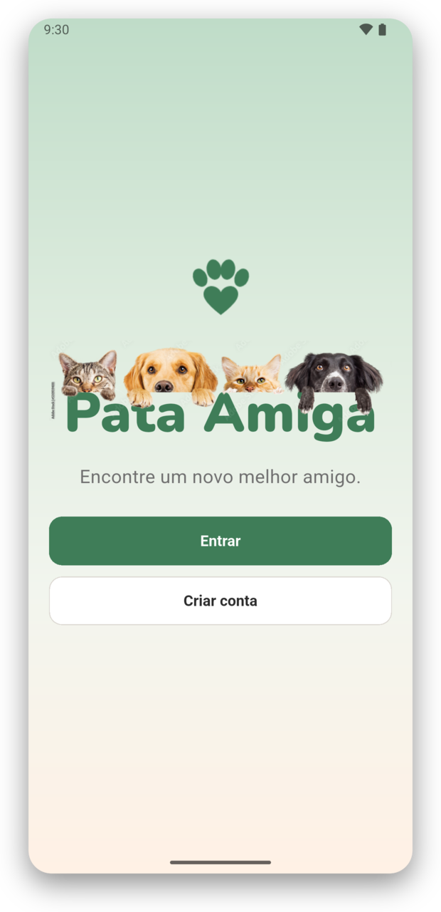<br>
      <strong>Boas-vindas</strong><br>
      <code>/</code><br>
      Apresenta o aplicativo e leva ao login ou à criação de conta.
    </td>
    <td width="33%" valign="top">
      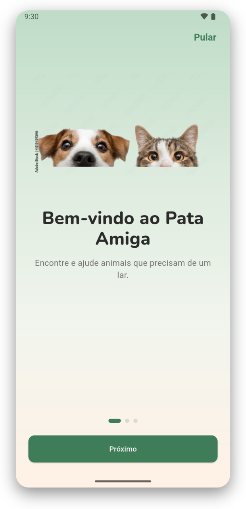<br>
      <strong>Onboarding, página 1</strong><br>
      <code>/onboarding</code><br>
      Abre o tutorial da primeira entrada com a proposta do aplicativo.
    </td>
    <td width="33%" valign="top">
      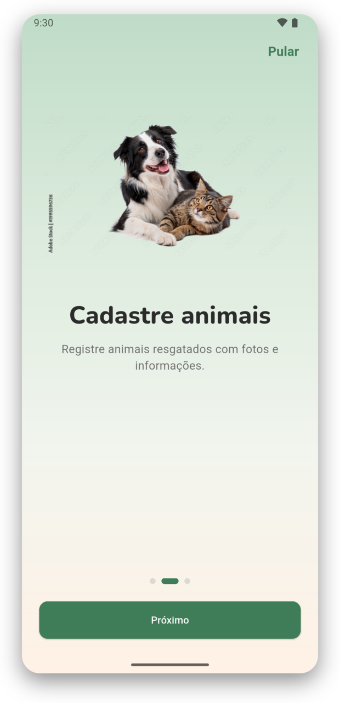<br>
      <strong>Onboarding, página 2</strong><br>
      <code>/onboarding</code><br>
      Explica o cadastro de animais resgatados, com fotos e informações.
    </td>
  </tr>
  <tr>
    <td width="33%" valign="top">
      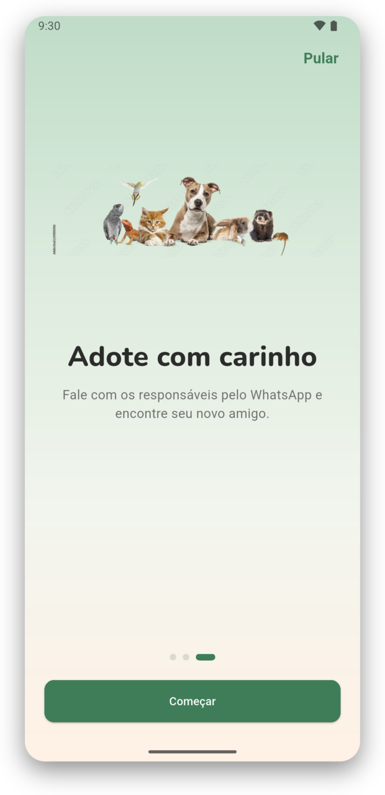<br>
      <strong>Onboarding, página 3</strong><br>
      <code>/onboarding</code><br>
      Explica a adoção e o contato com o responsável pelo WhatsApp.
    </td>
    <td width="33%" valign="top">
      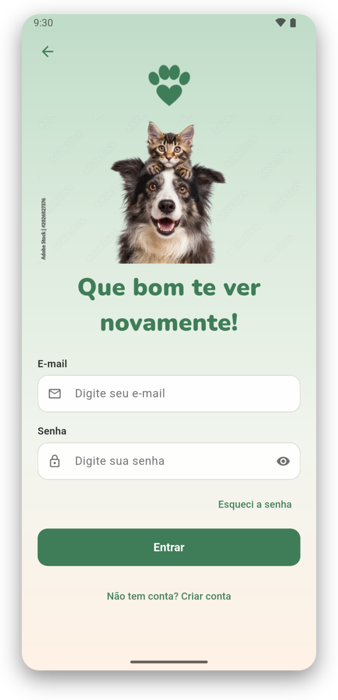<br>
      <strong>Login</strong><br>
      <code>/login</code><br>
      Autentica a conta pelo e-mail e pela senha e dá acesso à recuperação de senha.
    </td>
    <td width="33%" valign="top">
      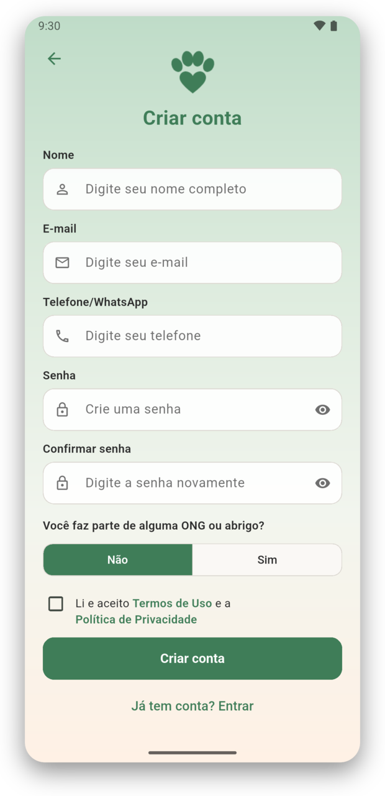<br>
      <strong>Criar conta</strong><br>
      <code>/cadastro</code><br>
      Cadastra nome, e-mail, telefone e senha, pergunta se a pessoa faz parte de uma ONG e exige o aceite dos termos.
    </td>
  </tr>
  <tr>
    <td width="33%" valign="top">
      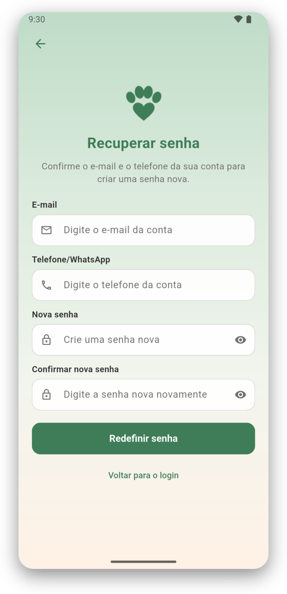<br>
      <strong>Recuperar senha</strong><br>
      <code>/recuperacao</code><br>
      Redefine a senha depois de confirmar o e-mail e o telefone da conta.
    </td>
    <td width="33%" valign="top">
      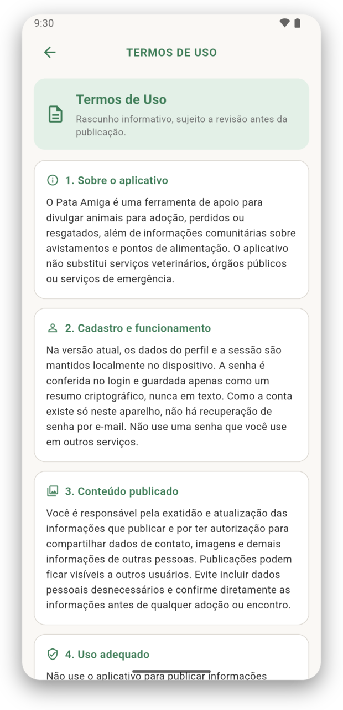<br>
      <strong>Termos de Uso</strong><br>
      <code>/termos-de-uso</code><br>
      Apresenta as regras de uso do aplicativo, divididas em seções.
    </td>
    <td width="33%" valign="top">
      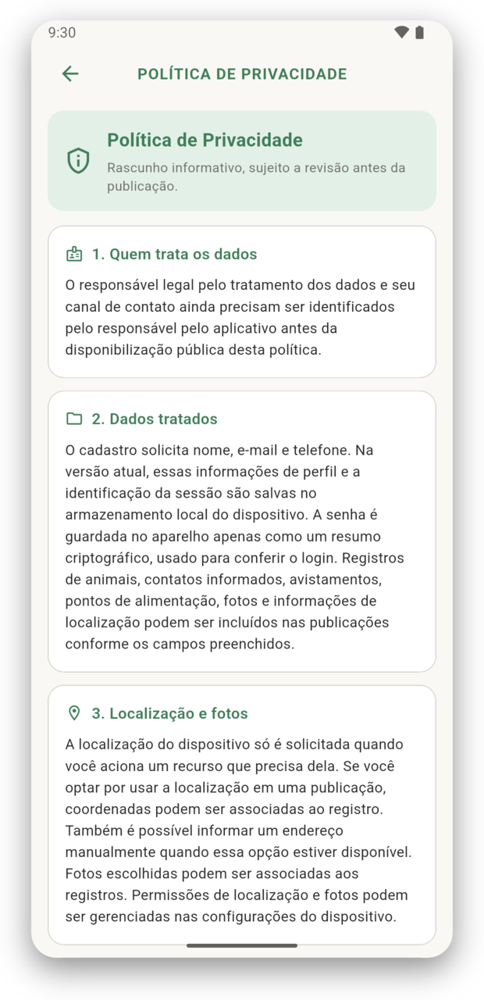<br>
      <strong>Política de Privacidade</strong><br>
      <code>/politica-de-privacidade</code><br>
      Informa quais dados o aplicativo trata, onde eles ficam guardados e como solicitar alterações.
    </td>
  </tr>
</table>

### Adoção

<table>
  <tr>
    <td width="33%" valign="top">
      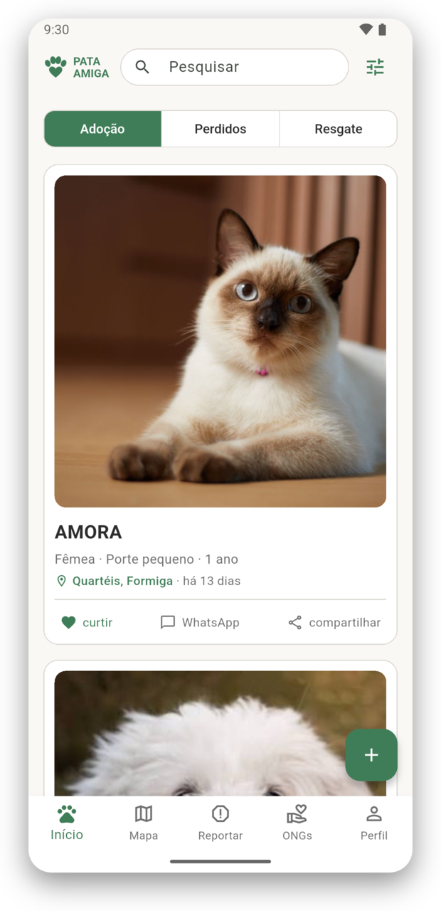<br>
      <strong>Feed</strong><br>
      <code>/feed</code><br>
      Lista os animais em rolagem contínua, separados em adoção, perdidos e resgate, com busca e filtros.
    </td>
    <td width="33%" valign="top">
      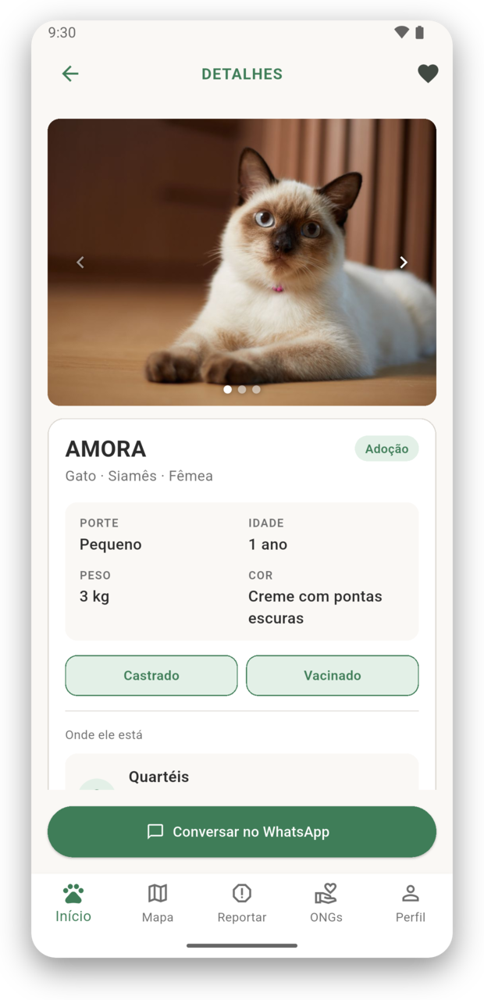<br>
      <strong>Ficha do animal</strong><br>
      <code>/detalhes-animal</code><br>
      Mostra as fotos, as características e os cuidados de saúde do animal e abre a conversa com o responsável pelo WhatsApp.
    </td>
    <td width="33%" valign="top">
      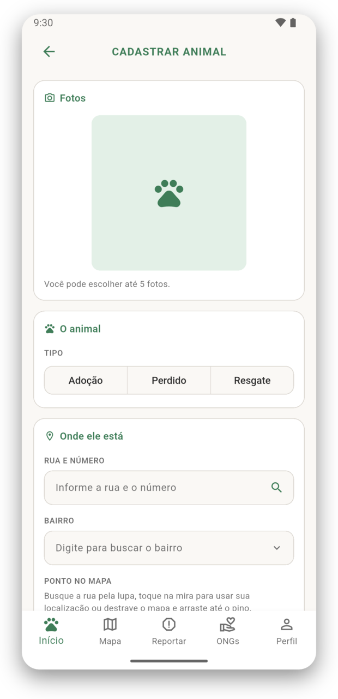<br>
      <strong>Cadastro de animal</strong><br>
      <code>/cadastro-animal</code><br>
      Publica um animal para adoção, perdido ou em resgate, com até cinco fotos e o local no mapa.
    </td>
  </tr>
</table>

### Perdidos e mapa

<table>
  <tr>
    <td width="33%" valign="top">
      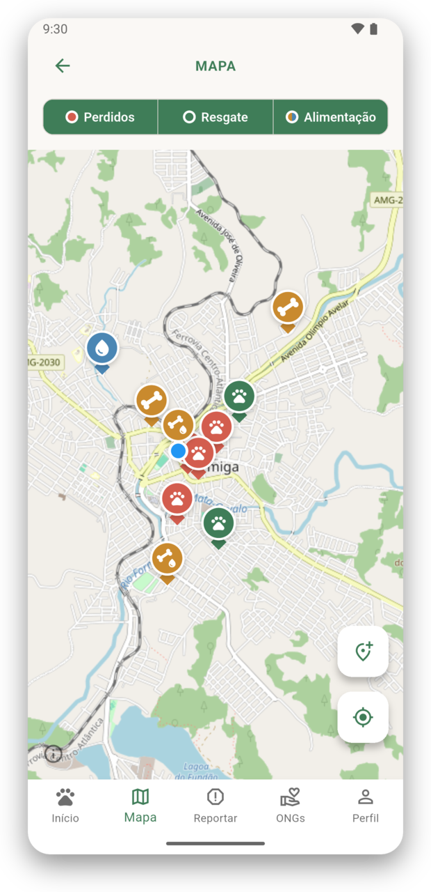<br>
      <strong>Mapa</strong><br>
      <code>/mapa</code><br>
      Exibe em camadas os perdidos, os resgates e os pontos de alimentação, com a posição de quem usa o aplicativo.
    </td>
    <td width="33%" valign="top">
      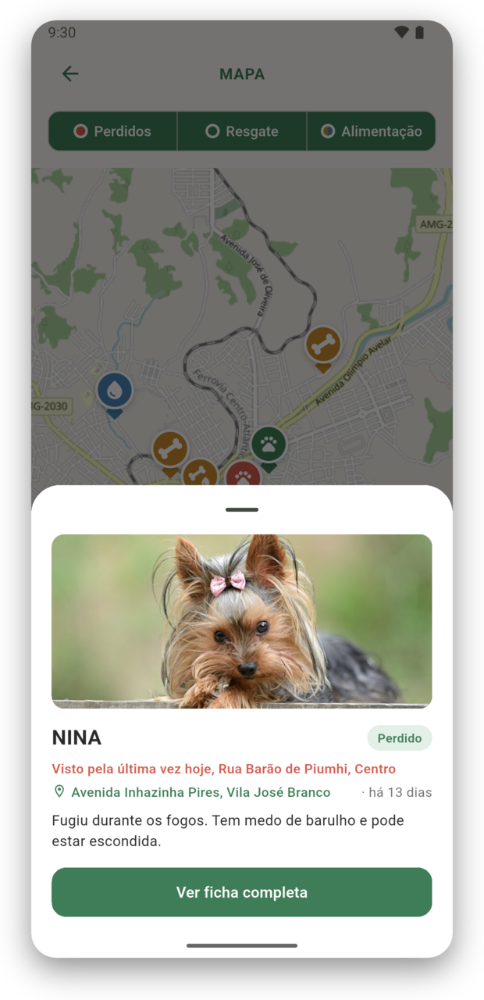<br>
      <strong>Pino de animal perdido</strong><br>
      <code>/mapa</code><br>
      Abre o resumo do animal com o último avistamento registrado.
    </td>
    <td width="33%" valign="top">
      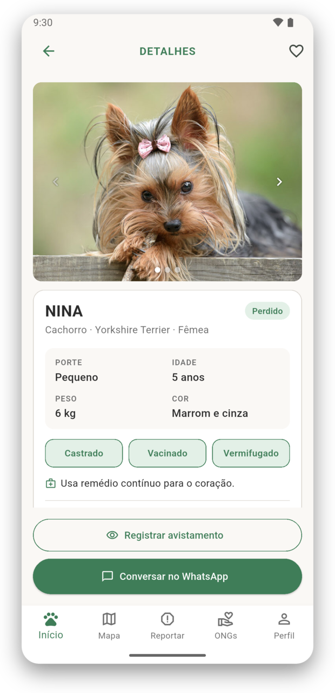<br>
      <strong>Ficha do animal perdido</strong><br>
      <code>/detalhes-animal</code><br>
      Acrescenta à ficha o registro de avistamento, usado por quem viu o animal.
    </td>
  </tr>
  <tr>
    <td width="33%" valign="top">
      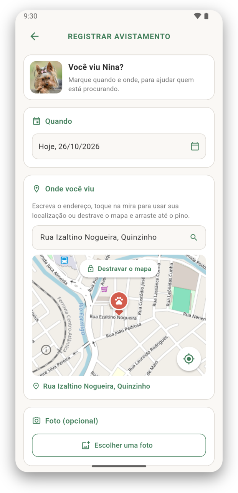<br>
      <strong>Registrar avistamento</strong><br>
      <code>/registrar-avistamento</code><br>
      Registra quando e onde o animal foi visto, com foto opcional, e avisa o tutor.
    </td>
    <td width="33%" valign="top">
      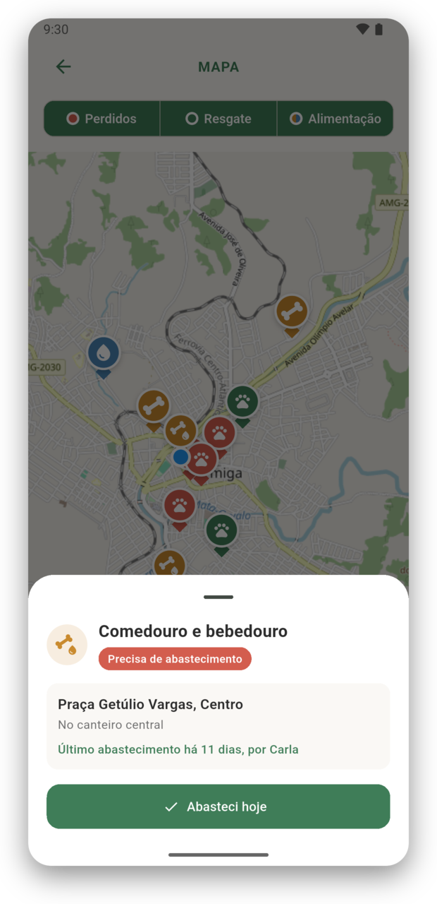<br>
      <strong>Pino de ponto de alimentação</strong><br>
      <code>/mapa</code><br>
      Mostra a situação do comedouro ou bebedouro e o último abastecimento.
    </td>
    <td width="33%" valign="top">
      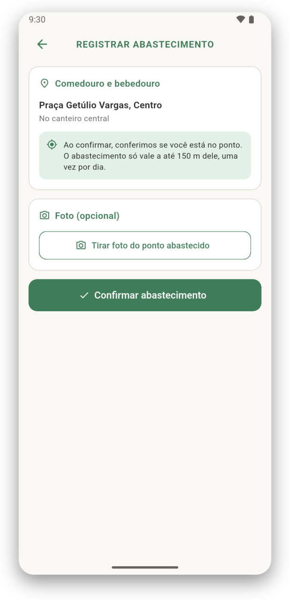<br>
      <strong>Registrar abastecimento</strong><br>
      <code>/registrar-abastecimento</code><br>
      Confirma o abastecimento do ponto, aceito só a até 150 m dele e uma vez por dia.
    </td>
  </tr>
  <tr>
    <td width="33%" valign="top">
      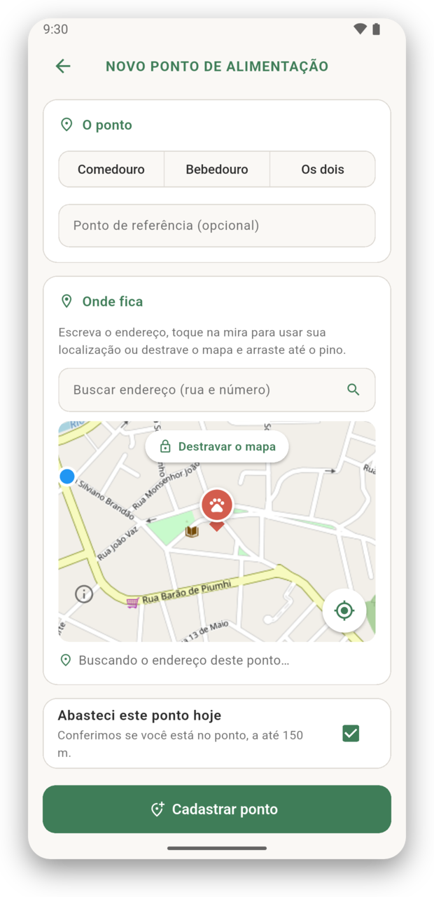<br>
      <strong>Cadastrar ponto</strong><br>
      <code>/cadastrar-ponto</code><br>
      Cadastra um comedouro ou bebedouro novo, com o endereço e a posição no mapa.
    </td>
  </tr>
</table>

### Denúncias

<table>
  <tr>
    <td width="33%" valign="top">
      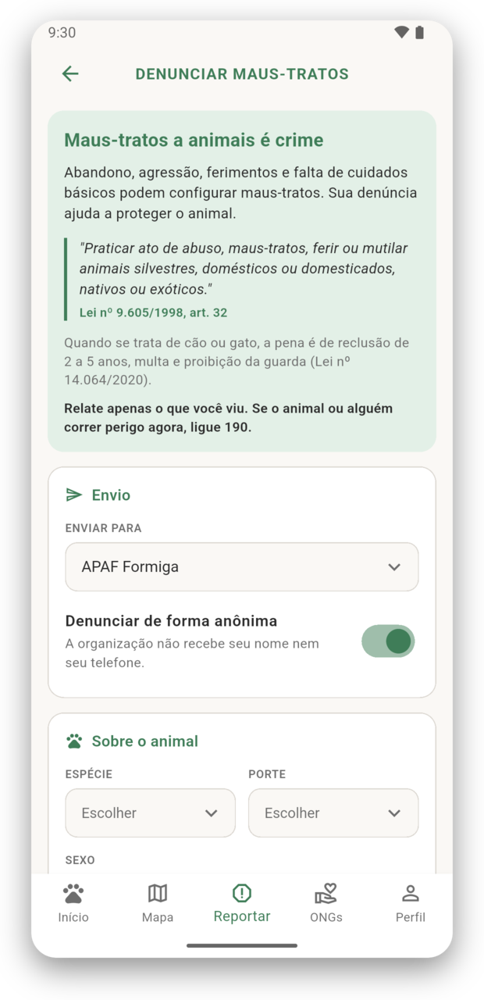<br>
      <strong>Denúncia de maus-tratos</strong><br>
      <code>/reportar</code><br>
      Registra a denúncia com a organização de destino, a opção de anonimato, os dados do animal, o relato e as fotos.
    </td>
    <td width="33%" valign="top">
      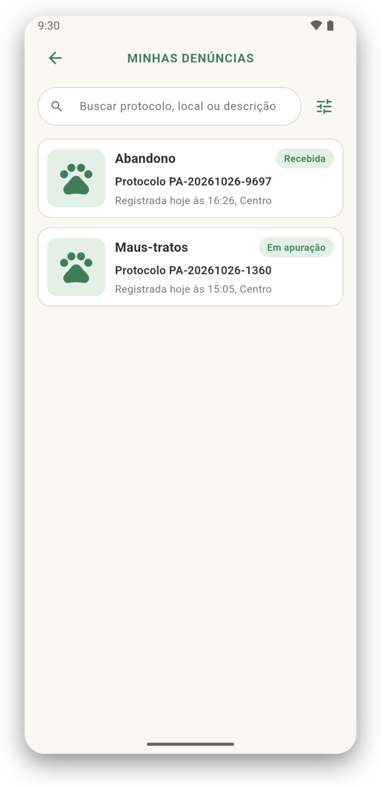<br>
      <strong>Minhas denúncias</strong><br>
      <code>/minhas-denuncias</code><br>
      Lista as denúncias feitas no aparelho, com protocolo e situação, e busca por protocolo, local ou descrição.
    </td>
    <td width="33%" valign="top">
      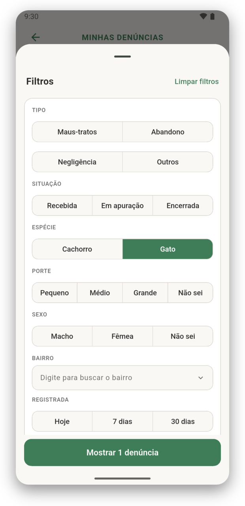<br>
      <strong>Filtro de denúncias</strong><br>
      <code>/minhas-denuncias</code><br>
      Filtra por tipo, situação, espécie, porte, sexo, bairro e data e mostra quantas denúncias vão aparecer antes de aplicar.
    </td>
  </tr>
  <tr>
    <td width="33%" valign="top">
      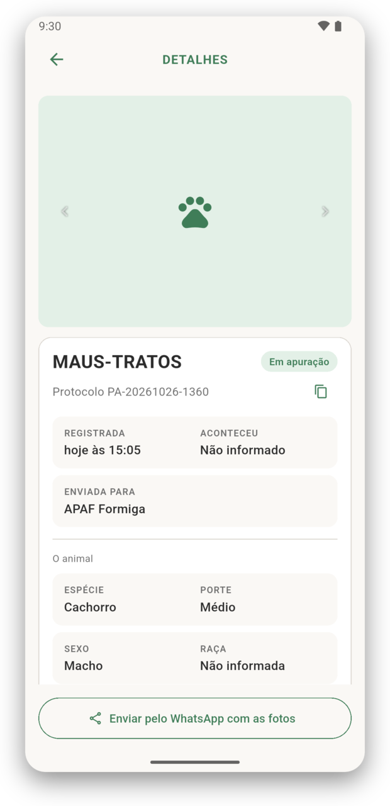<br>
      <strong>Ficha da denúncia</strong><br>
      <code>/detalhes-denuncia</code><br>
      Mostra o tipo, o protocolo, a situação, a organização de destino e os dados do animal.
    </td>
    <td width="33%" valign="top">
      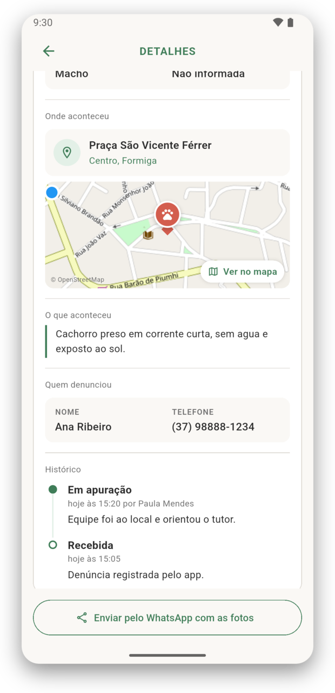<br>
      <strong>Histórico da denúncia</strong><br>
      <code>/detalhes-denuncia</code><br>
      Completa a ficha com o local no mapa, o relato, o denunciante e cada mudança de situação.
    </td>
  </tr>
</table>

### ONGs

<table>
  <tr>
    <td width="33%" valign="top">
      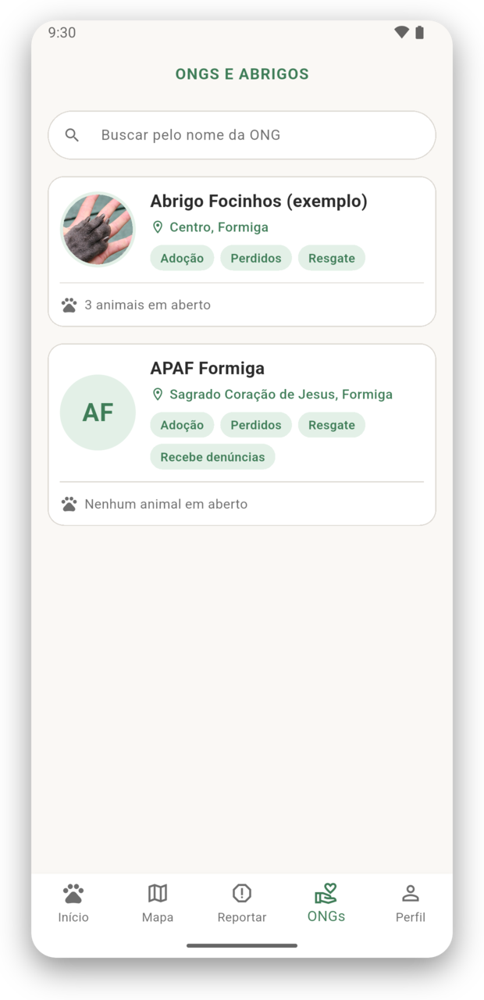<br>
      <strong>ONGs e abrigos</strong><br>
      <code>/ongs</code><br>
      Lista as organizações da cidade, com bairro, finalidades e animais em aberto, e busca pelo nome.
    </td>
    <td width="33%" valign="top">
      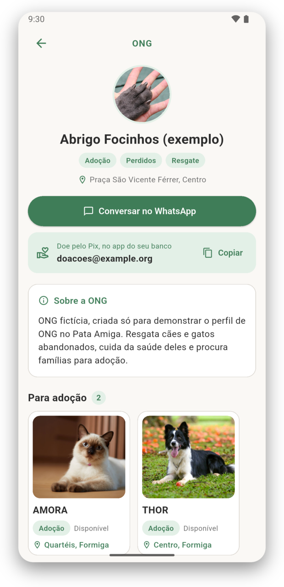<br>
      <strong>Perfil de ONG</strong><br>
      <code>/perfil-ong</code><br>
      Apresenta a organização, o contato pelo WhatsApp, a chave Pix e os animais publicados por ela.
    </td>
    <td width="33%" valign="top">
      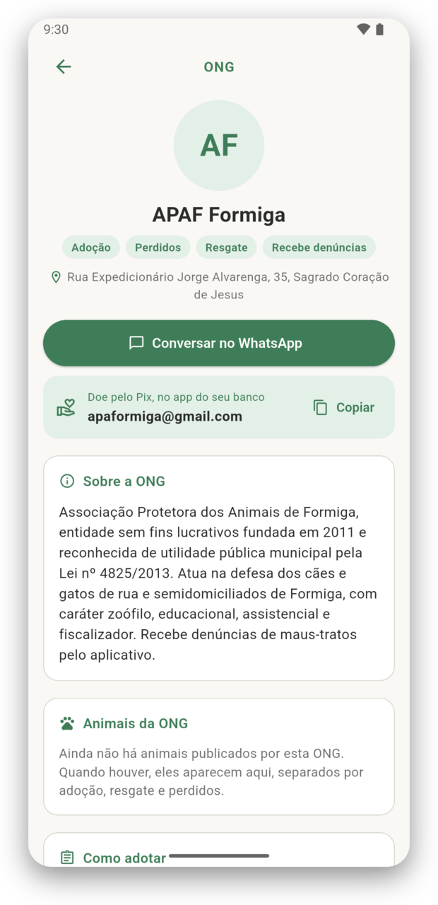<br>
      <strong>Perfil de ONG que recebe denúncias</strong><br>
      <code>/perfil-ong</code><br>
      Exibe a finalidade de receber denúncias e o aviso de quando a organização ainda não publicou animais.
    </td>
  </tr>
  <tr>
    <td width="33%" valign="top">
      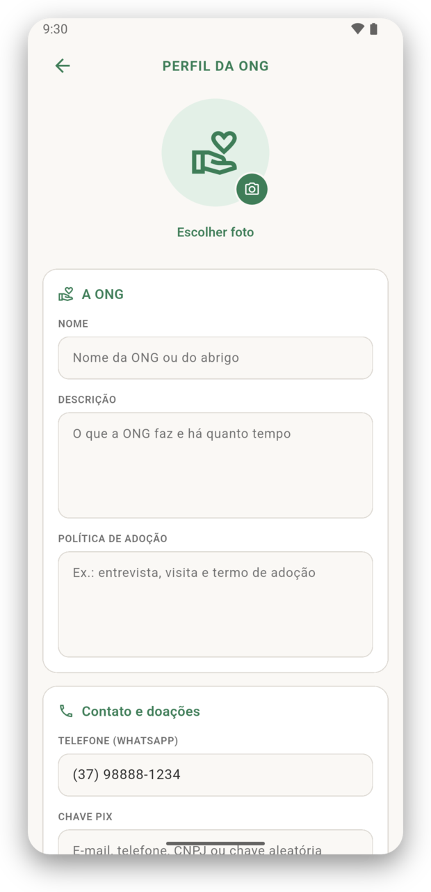<br>
      <strong>Cadastro de ONG</strong><br>
      <code>/cadastro-ong</code><br>
      Cria o perfil da organização com nome, descrição, política de adoção, telefone e chave Pix.
    </td>
  </tr>
</table>

### Perfil e configurações

<table>
  <tr>
    <td width="33%" valign="top">
      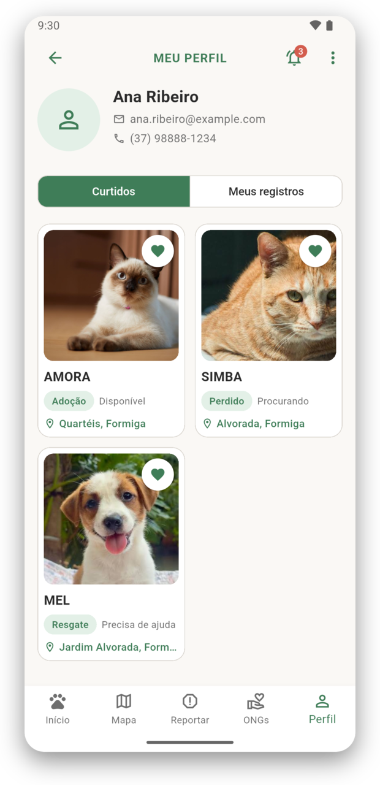<br>
      <strong>Meu perfil</strong><br>
      <code>/perfil-usuario</code><br>
      Reúne os dados da conta e os animais curtidos.
    </td>
    <td width="33%" valign="top">
      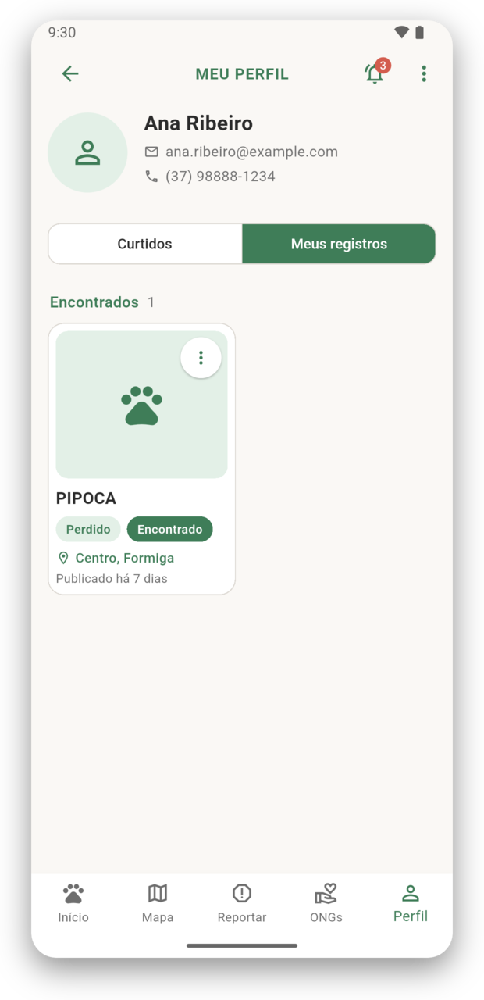<br>
      <strong>Meus registros</strong><br>
      <code>/perfil-usuario</code><br>
      Lista os animais publicados pela conta e a situação de cada um.
    </td>
    <td width="33%" valign="top">
      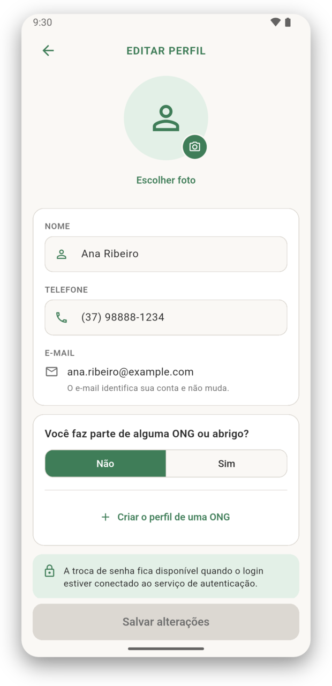<br>
      <strong>Editar perfil</strong><br>
      <code>/editar-perfil</code><br>
      Altera nome, telefone e foto e dá acesso à criação do perfil de uma ONG.
    </td>
  </tr>
  <tr>
    <td width="33%" valign="top">
      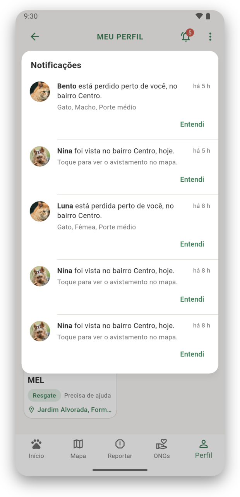<br>
      <strong>Notificações</strong><br>
      <code>/perfil-usuario</code><br>
      Avisa sobre animais perdidos a até 3 km, avistamentos e mudanças nas denúncias.
    </td>
    <td width="33%" valign="top">
      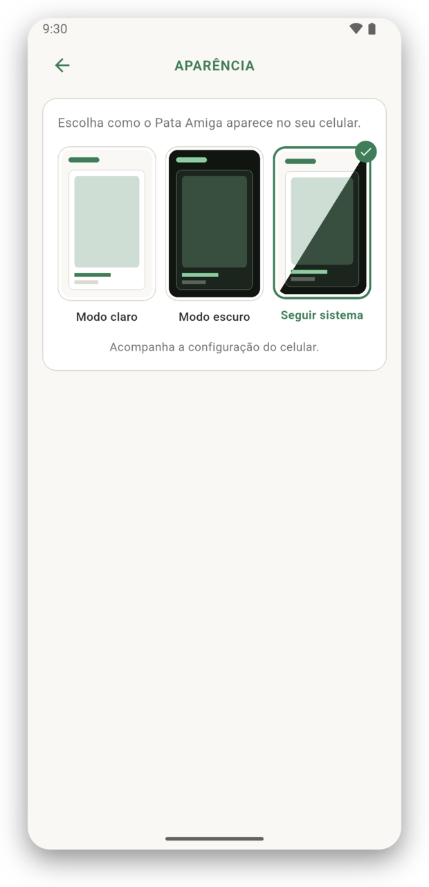<br>
      <strong>Aparência</strong><br>
      <code>/configuracoes-aparencia</code><br>
      Define o modo claro, o escuro ou o que acompanha o sistema.
    </td>
    <td width="33%" valign="top">
      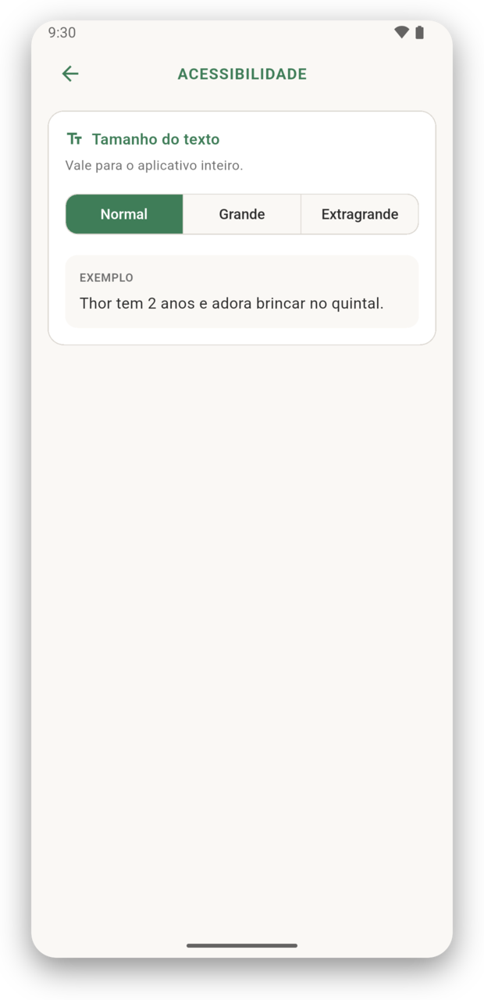<br>
      <strong>Acessibilidade</strong><br>
      <code>/configuracoes-acessibilidade</code><br>
      Ajusta o tamanho do texto do aplicativo inteiro, com um exemplo que muda na hora.
    </td>
  </tr>
</table>

## O que o aplicativo não faz

Algumas ausências são deliberadas e foram decididas na Sprint 0, não são
funcionalidades pendentes.

Não haverá conversa interna entre usuários. A tela do animal exibe os dados de
contato do responsável e leva a conversa para o telefone ou para o WhatsApp, fora
do aplicativo. A decisão tem motivo: uma conversa própria exigiria infraestrutura
de tempo real, moderação de conteúdo e tratamento de denúncias de abuso, esforço
incompatível com o prazo do semestre e sem ganho perceptível para um usuário que
já usa o WhatsApp todos os dias.

O aplicativo também não processa pagamentos nem doações. No perfil da ONG a chave
Pix é apenas exibida, para que a doação aconteça pelo aplicativo bancário do
próprio doador. Como a APAF depende de doações para se manter, o processamento
interno fica registrado como possibilidade futura, fora do escopo deste semestre.

Do mesmo modo, o aplicativo não gerencia o processo interno das instituições. Ele
registra a denúncia, entrega o caso à organização escolhida e guarda a situação
que ela informar de volta, seja ela recebida, em apuração ou encerrada.

Resta dizer quem é esse responsável, e aqui o squad trabalha com uma hipótese, não
com um acordo firmado. Supõe-se que a prefeitura de Formiga assuma o papel e
direcione cada caso conforme a natureza da ocorrência, encaminhando as denúncias
de maus-tratos à Polícia Civil ou ao órgão municipal competente, e os animais
perdidos ou abandonados às ONGs que atuam no resgate. Enquanto essa parceria não
for firmada, a denúncia fica registrada no aplicativo e vai para uma das
organizações cadastradas que recebem denúncias, escolhida por quem denuncia; nos
dados de exemplo, a APAF Formiga. Pelo mesmo motivo, o painel de denúncias do
administrador previsto na Sprint 0 (US 15) foi encerrado na Sprint 4: a triagem
pela prefeitura depende de uma parceria que ainda não existe.

Por fim, o Pata Amiga é desenvolvido como aplicativo independente, conforme o
escopo da disciplina. O squad reconhece que, em um cenário real, o destino natural
desta solução seria a integração ao aplicativo já mantido pela prefeitura, e o
produto construído aqui funciona, nesse sentido, como prova de conceito dessa
integração.

## Para quem

O produto atende cinco perfis. Os tutores e adotantes procuram um animal para
adotar ou perderam o próprio. As ONGs e órgãos de proteção animal fazem resgate,
acolhimento e encaminhamento para adoção, e precisam de um lugar onde o que
publicam permaneça. Os protetores independentes resgatam e cuidam por conta
própria, sem vínculo com nenhuma instituição, e hoje são justamente os que menos
alcance têm. A comunidade em geral entra quando alguém quer reportar um animal em
risco, registrar um avistamento ou denunciar maus-tratos. E as organizações que
recebem denúncias acompanham os casos enviados a elas e registram as
providências tomadas; na Sprint 0, esse papel era do poder público municipal,
que continua sendo o destino previsto caso a parceria com a prefeitura se
confirme.

## Backlog

O backlog inicial tem dezoito User Stories, escritas na Sprint 0 no formato
"como [persona], quero [ação], para [benefício]", cada uma com prioridade e
tamanho estimado. Doze são de prioridade alta, cinco médias e uma baixa. A
história completa e o critério de aceite de cada uma estão no documento da
Sprint 0, e todas são cadastradas como Issues no Issue Board deste repositório.

Ao longo do semestre, o backlog ganhou três histórias. A US 19 e a US 20 entraram
na Sprint 2, para as rotas centralizadas e o estado do usuário logado, e a US 21
entrou na Sprint 4, para as denúncias chegarem à organização responsável dentro
do aplicativo. Na mesma sprint, a US 15 foi encerrada sem implementação, porque a
US 21 atendeu à necessidade dela.

| # | História | Prioridade | Tamanho |
|---|---|---|---|
| 01 | Feed de animais para adoção | Alta | Grande |
| 02 | Cadastro e login de usuário | Alta | Média |
| 03 | Atualização do status do animal | Alta | Pequena |
| 04 | Notificação de animal perdido na região | Alta | Média |
| 05 | Cadastro de animal com anexos | Alta | Grande |
| 06 | Filtros de busca | Alta | Média |
| 07 | Feed de animais perdidos | Alta | Média |
| 08 | Mapa com camadas | Média | Grande |
| 09 | Gerenciamento dos meus registros | Alta | Média |
| 10 | Contato com o responsável pelo animal | Alta | Pequena |
| 11 | Denúncia de maus-tratos | Alta | Grande |
| 12 | Registro de avistamento | Alta | Média |
| 13 | Perfil de ONG ou abrigo | Média | Média |
| 14 | Mapa de comedouros e bebedouros | Baixa | Média |
| 15 | Painel de denúncias do administrador | Média | Grande |
| 16 | Tela de detalhes do animal | Alta | Média |
| 17 | Perfil do usuário | Média | Média |
| 18 | Meus curtidos | Média | Pequena |
| 19 | Rotas centralizadas do aplicativo | Alta | Pequena |
| 20 | Estado compartilhado do usuário logado | Alta | Média |
| 21 | Denúncias no perfil da ONG responsável | Média | Grande |

## O squad

Patinhas Gals Dev. Os papéis são rotativos e revisados a cada sprint, de modo que
todas as integrantes passem por todas as funções ao longo do semestre. A divisão
das Sprints 0 e 1 foi a mesma; a partir da Sprint 2, cada uma teve a sua.

| Integrante | GitLab | Sprints 0 e 1 | Sprint 2 | Sprint 3 | Sprint 4 |
|---|---|---|---|---|---|
| Yasmim Stefane Faria | @yasmimstefane | Tech Lead | Dev | Product Owner | Tech Lead |
| Maria Eduarda Siqueira Silva | @Mariyaduarda | Product Owner | Dev | Tech Lead | Dev |
| Júlia Cristina Martins | @Julia_Nakano | QA | Tech Lead | Dev | Product Owner |
| Luisa Caetano Araujo | @luisacaetano | Dev | Product Owner | QA | Dev |
| Maria Luzia Sanches | @marialuziademoura | Dev | QA | Dev | QA |

## Documentação

A pasta `documentacao/` guarda o material produzido nas sprints anteriores. O
documento de entrega da Sprint 0 traz a ata de formação do squad, o conceito do
produto, o elevator pitch, o backlog completo com os critérios de aceite e o
levantamento do ambiente de cada integrante. Os wireframes de baixa fidelidade
estão em `documentacao/wireframes/`, uma imagem por tela, e são a referência
visual que as telas implementadas devem seguir. As capturas do aplicativo
pronto estão em `documentacao/capturas/` e aparecem na seção Telas.

## Tecnologia

O aplicativo é escrito em Flutter 3.47 com Dart 3.13, o que permite atender
Android e iOS a partir de uma base única. A API de referência do projeto é a
[Pata Amiga API](https://github.com/PET-foundation/Pata-Amiga-API), escrita em
Java com Spring.

Enquanto o aplicativo não se conecta a ela, os dados vêm de uma API local
servida pelo [json-server](https://github.com/typicode/json-server) a partir do
arquivo `api/db.json`: animais, avistamentos, pontos de alimentação,
abastecimentos, ONGs e denúncias. As chamadas ficam nos serviços de
`lib/services/`, e o feed guarda uma cópia dos animais no aparelho com
`shared_preferences`, por meio de `lib/services/cache_service.dart`, o que
permite continuar mostrando os animais sem internet e avisar na tela se o dado
veio do cache ou acabou de ser atualizado.

O estado compartilhado fica em três `ChangeNotifier`: o do usuário logado e o
das preferências, expostos pelo `provider`, e o `EstadoPataAmiga`, com os
animais, as curtidas, as ONGs e as notificações, exposto por um
`InheritedNotifier`. A navegação passa
por um arquivo único de rotas, em `lib/routes/`. O mapa usa o `flutter_map` com
os mapas públicos do OpenStreetMap, a localização do aparelho vem do
`geolocator`, e o encaminhamento de uma denúncia com as fotos, pelo
compartilhar do celular, usa o `share_plus`.

Na Sprint 4, o agente de código oficial do squad é o GitHub Copilot. As regras
que descrevem a arquitetura real do app para o agente estão em
`.github/copilot-instructions.md`, e o MCP server do Dart e Flutter, que permite
ao agente rodar o `flutter analyze` e os testes por conta própria, está
configurado em `.github/mcp.json`. Parte das entregas também foi feita com o
Claude Code, e cada Merge Request informa qual agente foi usado.

## Arquitetura

O código fica em `lib/`, separado pelo papel de cada arquivo:

```
lib/
├── main.dart    inicia o app, restaura a sessão e registra o estado
├── auth/        entrada no app: boas-vindas, login, cadastro, recuperação
│                de senha e documentos legais
├── telas/       telas usadas depois do login
├── widgets/     componentes reaproveitados entre as telas
├── estado/      EstadoPataAmiga, o estado compartilhado dos dados do app
├── provider/    usuário logado e preferências de aparência e de texto
├── services/    acesso à API, ao cache, ao GPS e à busca de endereço
├── modelos/     classes de dados e regras sem tela, como filtros e alertas
├── dados/       listas fixas, como os bairros de Formiga e as raças
├── routes/      nomes das rotas e a tabela que liga cada nome à sua tela
└── tema/        cores do tema claro e do escuro
```

O projeto não usa os nomes ViewModel e Repository, mas separa as mesmas
responsabilidades em quatro camadas:

- **Interface (`auth/`, `telas/` e `widgets/`).** Desenha a tela, recebe as
  ações de quem usa o app e mostra os estados de carregamento, de erro e de
  lista vazia.
- **Estado (`estado/` e `provider/`), no papel do ViewModel.** Três
  `ChangeNotifier` guardam o que mais de uma tela precisa ler: o
  `UsuarioProvider`, com quem está logado; o `PreferenciasAplicativoProvider`,
  com o tema e o tamanho do texto; e o `EstadoPataAmiga`, com os animais, as
  curtidas, as ONGs, os avistamentos, os pontos de alimentação e as
  notificações. Quando um deles muda, as telas que o escutam são reconstruídas.
- **Serviços (`services/`), no papel do Repository.** Cada serviço conversa com
  uma fonte de dados: a API, pelo pacote `http`; o armazenamento do aparelho;
  o GPS; ou a busca de endereço. As telas recebem o serviço pelo construtor, o
  que permite trocar a API por uma versão falsa nos testes.
- **Modelos (`modelos/`).** As classes de dados, a conversão de e para JSON e
  as regras que não dependem de tela, como os filtros do feed e das denúncias e
  o cálculo de quem recebe o aviso de animal perdido. Por não depender de tela,
  essa camada é testada isoladamente, em `test/modelos/`.

O fluxo de um dado segue sempre o mesmo caminho. A tela pede ao serviço, o
serviço busca na API e devolve modelos, a tela entrega o resultado ao estado, e
toda tela que escuta aquele estado se atualiza. Uma curtida feita no feed, por
exemplo, aparece na mesma hora no perfil, sem que uma tela precise avisar a
outra.

**Navegação.** As rotas têm nome, definido em `lib/routes/route_names.dart`, e
a tabela que liga cada nome à sua tela fica em `lib/routes/app_router.dart`.
Quando uma tela precisa de um dado para abrir, como a ficha de um animal, ele
vai como argumento da rota. Depois do login, a barra inferior leva às cinco
áreas principais: Início, Mapa, Reportar, ONGs e Perfil.

**Persistência.** O que pertence ao aparelho fica no `shared_preferences`: a
sessão, o perfil, as curtidas, a cópia dos animais para uso sem internet, o
tema e o tamanho do texto, o tutorial já visto, os protocolos das denúncias
feitas e as notificações dispensadas. A senha nunca é gravada: o aparelho
guarda só um resumo SHA-256 dela, calculado com um sal sorteado. O que precisa
ser visto por outras pessoas, como os animais publicados, os avistamentos e as
denúncias, vai para a API.

## Pacotes utilizados

| Pacote | Uso no aplicativo |
|---|---|
| `provider` | Expõe o usuário logado e as preferências às telas. |
| `http` | Faz as chamadas à API. |
| `shared_preferences` | Guarda no aparelho a sessão, o perfil, as preferências e o cache do feed. |
| `crypto` | Calcula o resumo SHA-256 da senha. |
| `flutter_map` | Mostra o mapa com as camadas e o mapa de local nos formulários. |
| `latlong2` | Representa as coordenadas usadas pelo mapa. |
| `geolocator` | Obtém a posição do aparelho, com o pedido de permissão. |
| `geocoding` | Converte endereço em coordenada e coordenada em endereço. |
| `image_picker` | Escolhe fotos da galeria ou tira pela câmera. |
| `share_plus` | Compartilha um animal e encaminha a denúncia com as fotos. |
| `url_launcher` | Abre a conversa no WhatsApp com o responsável pelo animal ou com a organização. |
| `flutter_localizations` | Traduz para o português os componentes do Flutter, como o calendário. |
| `flutter_native_splash` | Gera a tela de abertura do Android e do iOS. |

Nos testes, entram também o `flutter_test`, o `flutter_lints`, que define as
regras do `flutter analyze`, e as interfaces de plataforma do `image_picker`,
do `geocoding` e do `plugin_platform_interface`, usadas para trocar a galeria,
o GPS e a busca de endereço por versões falsas.

## Como rodar

O feed depende da API local, então ela precisa estar no ar antes do aplicativo.
Em um terminal, na raiz do projeto:

```
npx json-server api/db.json --port 3000
```

O app funciona com o `json-server` 0.17 e com o 1.x. A versão 1.x devolve os
ids em texto (por exemplo `"id": "1"`), e o app aceita os dois formatos.

Com a API respondendo em `http://localhost:3000/animais`, em outro terminal:

```
flutter pub get
flutter run
```

O endereço da API está em `lib/services/endereco_da_api.dart` e já muda conforme
onde o aplicativo roda: `10.0.2.2` no emulador Android, que é como ele enxerga o
computador, e `localhost` no Chrome e no desktop. Em um celular de verdade, troque
pelo IP do computador na rede. Sem a API no ar, o feed mostra o que estiver em cache ou um aviso de que
não conseguiu buscar os dados.

Para escolher onde rodar, use `flutter devices` e depois
`flutter run -d <dispositivo>`. Antes de abrir um Merge Request, rode
`flutter analyze` e `flutter test`.

## Como trabalhamos

Nenhum código entra na `main` direto. Cada integrante trabalha em uma branch
própria, nomeada pela funcionalidade em que está mexendo, e abre um Merge Request
explicando o que fez.

A QA da sprint é a revisora padrão de todo Merge Request e testa a tela na
prática antes de aprovar. Se estiver ocupada, qualquer outra integrante pode
cobrir. A regra que não muda é que ninguém aprova o próprio Merge Request. Depois
da aprovação, quem faz o merge é a própria autora, que escolhe o momento certo.

O andamento fica registrado na Issue fixa "Daily Sprint", a mesma em todas as
sprints, onde cada integrante comenta, a cada dia de aula, o que fez, o que vai
fazer em seguida e se está travada em alguma coisa. Isso substitui a daily
presencial de uma squad remota. Ao fim de cada sprint, a retrospectiva fica em uma
Issue própria, "Retro Sprint N".

A partir da Sprint 4, parte do código é escrita com ajuda de um agente de IA, e a
regra do Merge Request vale para ele também: nenhum código gerado por IA entra na
`main` sem revisão de outra integrante, e o agente não faz commit nem push direto
nela. Cada Merge Request feito com IA traz o pedido enviado ao agente, o plano
aprovado pelo squad e a lista do que precisou ser corrigido no código gerado, e o
uso da semana fica registrado na Issue fixa "Diário de IA" da
Sprint 4, com pelo menos uma entrada de cada integrante.

## Sprints

| Sprint | Entrega | Situação |
|---|---|---|
| 0 | Kickoff: formação do squad, conceito do produto, backlog e wireframes | Entregue |
| 1 | Primeiras Telas: telas do MVP, backlog no Issue Board e fluxo de Merge Request | Entregue |
| 2 | Produto Conectado: rotas centralizadas, estado compartilhado, cadastro, login e perfil | Entregue |
| 3 | Produto Resiliente: cache local, estados de conectividade na tela e preferência salva | Entregue |
| 4 | Squad com IA: agente com o MCP do Flutter, arquivo de rules, funcionalidade e testes com IA | Entregue |
